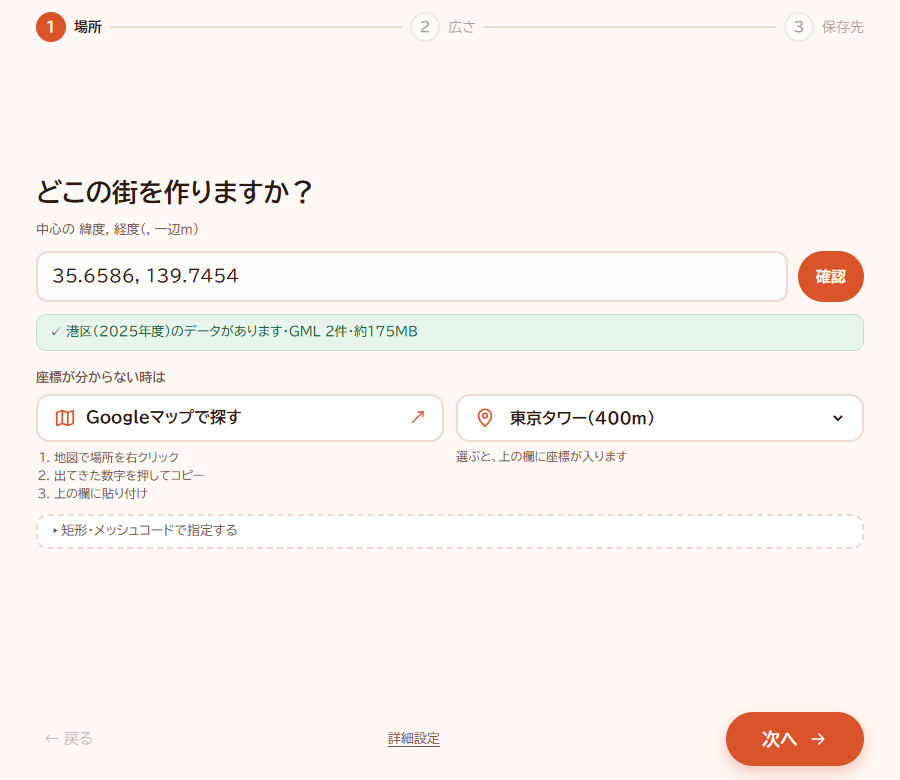

# PLATEAU Blender Bridge

**場所を選んで、街をBlenderへ。**

場所（緯度・経度）を選ぶだけで、国土交通省 Project PLATEAU の 3D 都市モデルと国土地理院の地理院タイル（航空写真・標高）を自動で集め、Blender で開ける `.blend` を作る Windows 向けの道具です。

- 利用者は Python 不要。ZIP を展開して `PLATEAU-Blender-Bridge.exe` を開くだけ。
- 画面は「場所 → 広さ → 保存先」の3問に答える形。
- 一時保存した `.blend` を別の Blender プロセスで開き直し、建物・地形・写真・座標を検証してから、正式な保存先へ移します。

> **使う人へ**：配布 ZIP の中の `はじめにお読みください.txt`（画像つきは `使い方ガイド.html`）を読んでください。開発・ビルドの手順は、このページの後半にあります。


## 使い始めるには

### Windowsアプリを使う

用意するものは Windows 10 / 11（64ビット）、Microsoft Edge、Blender、インターネット接続です。Blender本体は同梱しません。

配布ZIPを受け取ったら、書き込める場所に展開して `PLATEAU-Blender-Bridge.exe` を開きます。`_internal` と `tools` は同じフォルダに置いてください。

初回起動時に Windows SmartScreen の警告が出ることがあります。「詳細情報」→「実行」で起動してください。Edge の画面表示用プロファイルは `%LOCALAPPDATA%\PLATEAU-Blender-Bridge` に作られます。アプリを消す時は、このフォルダも削除してください（次に起動すると作り直されます）。

1. 場所を選ぶか、緯度・経度を入力して、データがあるか確認します。
2. 広さを選びます。初めてなら200m四方から試せます。「地図で範囲を確認」を開くと、指定した範囲と中心が見えます。
3. 保存先を選び、「3Dの街を作る」を押します。ファイル名は場所や広さに応じて提案されます。
4. 完了したら「保存した .blend を開く」を押します。Windowsで .blend に関連付けたアプリで開きます。ファイルの場所は「保存したフォルダを開く」で確認できます。



画面は作成時点のものです。詳しい操作と出典の書き方は、[利用者向けの説明書](packaging/user_docs/はじめにお読みください.txt)にあります。画像つきの `使い方ガイド.html` は配布フォルダ内で開いてください。

このリポジトリにはソースコードを置いています。GitHubの「Code → Download ZIP」はソースの取得用で、実行ファイルの配布ZIPとは異なります。実行ファイル入りの配布ZIPは [Releases](https://github.com/aiuex0000/plateau-blender-bridge/releases) で配布しています。

### できることと対象範囲

- PLATEAUの建物、地理院タイルの標高・航空写真を組み合わせ、写真を埋め込んだ `.blend` を作ります。
- 対象はPLATEAUの建物データがある地域です。地域・年度ごとに建物の詳しさや収録内容は異なります。
- 取得元に必要なデータがない場所では生成できない場合があります。広い範囲ほど取得量と処理時間が増えます。
- 生成物には出典と取得の記録を添えます。利用・発表時は、各データの利用条件と出典の指定を確認してください。

## AIを活用した開発について

このアプリは、生成AI（Claude・Codex）を活用して開発しています。人が要件や操作方針を決め、実装・文書作成・レビュー・テストの作業にAIを使用しています。

生成する街の建物・地形・航空写真は、PLATEAUと国土地理院のデータに基づきます。それぞれの出典と利用条件は、下の「データの出典と利用条件」を確認してください。

## しくみ

```
場所の入力
  → [1] PLATEAU API で、その範囲の CityGML（建物）を探す
  → [2] nusamai で CityGML を OBJ に変換し、範囲で切り出す
  → [3] 地理院タイルから航空写真と標高を集め、写真つきの地形を作る
  → [4] Blender（裏で起動）で組み立てて .blend に保存 → 開き直して検証
```

- 座標は JGD2011 の平面直角座標系（19系）から、場所に合う系を自動で選びます（`EPSG: AUTO`）。
- 生成物の隣に、出典と取得の記録 `scene.provenance.json` と、作業用フォルダ `scene.work/` ができます。
- Blender 本体は同梱しません（利用者が入れる）。nusamai は Windows 版が公式に無いので、`build_nusamai.bat` でビルドして `tools/nusamai/` に同梱します（当てているパッチは `patches/`）。

### 画面

`plateau_blend/web/` の手書き HTML/CSS/JS を、アプリ内の小さな HTTP サーバー（`plateau_blend/web_server.py`、`127.0.0.1` のみ・起動ごとの token つき）から配り、Microsoft Edge のアプリ窓（`--app`）で開きます。画面から Python を呼ぶ面は `plateau_blend/web_gui.py` の `BridgeApi` です。

- ポータブルアプリなので、アプリが書く物（ログと Edge の専用プロファイル）は exe の隣の `data\` に置き、`%LOCALAPPDATA%` などフォルダの外へは書きません（`plateau_blend/app_paths.py`）。フォルダが書き込めない時だけ一時フォルダを使います。開発時は repo 直下の `data\`（git 管理外）。作った街の保存先も、既定は exe の隣の `作った街\`（書けなければ `Documents\PLATEAU`）。
- Edge は専用プロファイル（`data\edge-profile`）を同期・拡張なしで開きます。
- 窓を閉じると、画面の `pagehide` からの合図を受けて約3秒でアプリも終わります。合図が届かない場合は、最後の心拍から180秒で終了します。
- 新画面を開けない時は Tk の予備画面（`plateau_blend/auto_gui.py`）へ切り替わり、理由を `data\logs\gui-fallback-*.log` に残します。`data` に書き込めない場合、ログは Windows の一時フォルダ内の `PLATEAU-Blender-Bridge\logs` に残します。
- 経緯：2026-11 までは pywebview（WebView2）でしたが、ネットから落とした ZIP の Mark of the Web で .NET の DLL 読込が止まり、予備画面へ落ちる問題があったため載せ替えました（`docs/gui_edge_app_2026-11-05.md`）。

## フォルダ

```text
plateau_launcher.py   凍結 exe の入口（--self-check / --cli / --manual / --legacy）
plateau_blend/
  web_gui.py          新しい画面の Python 側（BridgeApi）と Edge の起動・終了判定
  web_server.py       画面を配るローカル HTTP サーバー
  web/                画面の HTML / CSS / JS
  auto_gui.py         Tk の予備画面（文言と補助関数の正本でもある）
  auto.py             自動取得と生成のとりまとめ
  auto_cli.py         CLI
  catalog.py          PLATEAU API・CityGML の取得
  converter.py        nusamai の呼び出し
  clip.py, subset.py  範囲での切り出し
  gsi.py              地理院タイル（写真・標高）と再投影
  crs.py              平面直角座標系の自動選択
  pipeline.py         Blender での生成と記録
  blender_scene.py    Blender の中で動くコード
  blender_verify.py   保存した .blend の開き直し検証
  gui.py, cli.py      手動 OBJ モード（旧ワークフロー）
packaging/
  plateau_bridge.spec PyInstaller の設定
  dist_extras.py      exe の隣へ説明書と THIRD_PARTY_LICENSES.txt を置く
  user_docs/          利用者向けの説明書と画像（ZIP にそのまま入る）
tests/                オフラインのテスト（実 Blender・ネットは使わない）
docs/                 設計・確認の記録（docs/history は旧 README など）
patches/              nusamai に当てるパッチ
```

## 開発の始め方

必要なもの：Windows、Python 3.10 以上（`py` ランチャー）、Blender（実際に生成する時）。nusamai をビルドする場合は Git、Rust の `cargo` と Windows向けのRustビルド環境も必要です。

```powershell
# 開発用の .venv を作る（このフォルダの中だけに入る）
.\dev_setup_windows.bat

# 自動生成に使う nusamai をビルド（初回。Git・Rust のビルド環境が必要）
.\build_nusamai.bat

# 新しい画面で起動
.\start_dev_gui.bat

# テスト（オフライン）
.venv\Scripts\python.exe -m unittest discover -s tests
```

CLI でも動かせます。

```powershell
# 道具の検出だけ
.venv\Scripts\python.exe -m plateau_blend.auto_cli --diagnose

# 何を取得するかの確認（ダウンロードしない）
.venv\Scripts\python.exe -m plateau_blend.auto_cli --condition "r:135.429,34.819,135.431,34.821" --epsg AUTO --output scene.blend --preview

# 取得して生成
.venv\Scripts\python.exe -m plateau_blend.auto_cli --condition "r:135.429,34.819,135.431,34.821" --epsg AUTO --output scene.blend
```

ログは `<scene>.work/last_blender.log`、`<scene>.work/auto/converter/last_converter.log`、取得の記録は `<scene>.work/auto/acquisition.json` にあります。

## 配布物を作る

```powershell
.\build_windows.bat
```

1. `.build-venv` を作って依存と PyInstaller を入れる
2. `build_nusamai.bat` で nusamai をビルド
3. テスト
4. PyInstaller（`packaging/plateau_bridge.spec`）で `dist\PLATEAU-Blender-Bridge\` を作る。spec の最後で `packaging/user_docs/` の説明書と、ビルド環境のライセンス原文を集めた `THIRD_PARTY_LICENSES.txt` を exe の隣に置く（原文が見つからなければビルドを止める）
5. 凍結 exe の `--self-check`

GitHub Actions（`.github/workflows/windows-build.yml`）でも同じ流れで ZIP を作れます（`build_nusamai.bat` で nusamai もビルドして同梱します）。

### 配る前の確認

- 試しのビルドは `--distpath dist-next --workpath build-next` に出し、`--self-check` が合格してから `dist` と入れ替える。
- **ZIP から展開した状態を再現して確かめる**：ネットから落とした ZIP の中身には Mark of the Web（`Zone.Identifier`）が付きます。写しの全ファイルに付けてから起動し、新しい画面で開くこと・`gui-fallback-*.log` が増えないことを見る。手順の例は `docs/gui_edge_app_2026-11-05.md`。
- ZIP は `PLATEAU-Blender-Bridge/` を最上位にする。

## データの出典と利用条件

- **PLATEAU**：3D 都市モデルの著作権は各地方公共団体にあり、都市・データセットごとにライセンス（CC BY 4.0、公共データ利用規約など）が示されています。授業・社内利用も含め、使う前にそのデータの配布ページで利用条件と出典の指定を確認してください。[PLATEAU サイトポリシー](https://www.mlit.go.jp/plateau/site-policy/)、[FAQ](https://www.mlit.go.jp/plateau/faq/)
- **地理院タイル**：出典の明示と、加工した旨の表示が必要です。全国最新写真（シームレス）には他機関の写真が含まれ、追加の出典が要る場合があります。[国土地理院コンテンツ利用規約](https://www.gsi.go.jp/kikakuchousei/kikakuchousei40182.html)、[地理院タイル一覧](https://maps.gsi.go.jp/development/ichiran.html)
- **PLATEAU API**：[API 仕様](https://docs.plateauview.mlit.go.jp/api/rest/)。連続アクセスを増やす変更をする時は、利用条件を確認してください。
- 生成した `.blend` と `scene.provenance.json` には基本の出典を記録しますが、公開時の出典確認の代わりにはなりません。

## ライセンス

- 同梱しているサードパーティのソフトウェアのライセンスは、配布物の `THIRD_PARTY_LICENSES.txt` にまとめています（ビルド時に自動生成）。
- 本体のソースコードと独自の文書は [MIT License](LICENSE) で公開しています。著作権表示は `Copyright (c) 2026 aiuex0000` です。
- 同梱ソフトウェアには、それぞれのライセンスが適用されます。PLATEAU・地理院タイルなどの取得データには各配布元の利用条件が適用され、本体のMITライセンスで置き換わるものではありません。

## 変更履歴

[CHANGELOG.md](CHANGELOG.md)（v0.10 は [CHANGELOG-v0.10.md](CHANGELOG-v0.10.md)）。旧版の README は [docs/history/README_v0.10.md](docs/history/README_v0.10.md)。
